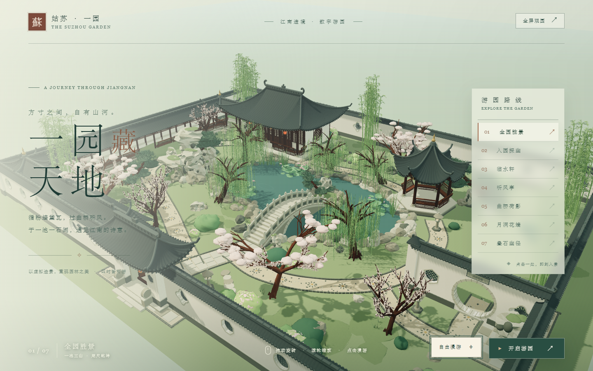

# 一园藏天地 · 苏州园林漫游

基于 **Three.js + Vite** 的苏州园林三维交互漫游。方寸之间，自有山河——一池三山、曲桥荷影、月洞花墙、叠石幽径，全程程序化建模，无外部模型与贴图资源。



## 快速开始

要求 **Node.js ≥ 20.19**（Vite 7 的要求）。

```bash
npm install
npm run dev
```

然后打开终端里提示的地址（默认 <http://127.0.0.1:5173/>）即可入园。

## 操作方式

| 操作 | 说明 |
| --- | --- |
| 拖动 / 滚轮 | 旋转、缩放视角 |
| 左侧路线列表 | 七个造景视角一键切换 |
| 自由漫游 | 进入步行模式：`WASD` 移动，拖动转视角，`Esc` 返回 |
| 开启游园 | 自动循环游览全部七个视角 |
| 全屏观看 | 右上角按钮进入全屏 |

## 常用脚本

```bash
npm run dev      # 启动开发服务器
npm run build    # 构建生产版本到 dist/
npm test         # 运行单元测试（node --test）
npm run lint     # ESLint 检查
node tests/visual-check.mjs   # E2E 视觉检查（需先 npm run build 并在 4173 端口起 preview）
```

## 代码结构

```
index.html               入口页面（含界面样式与文案）
src/main.js              场景、相机、灯光、交互与渲染循环
src/garden/layout.js     园林坐标数据：边界、池岸、地标、观景视角、步行规则
src/garden/landscape.js  地形：地面、池塘、驳岸、路径、庭院、叠石、花坛
src/garden/architecture.js 建筑：围墙、门楼、临水轩、听风亭、游廊、月洞门、拱桥
src/garden/vegetation.js 植被：柳、松、梅樱、竹丛、灌木、草花、荷花
src/garden/materials.js  程序化生成材质贴图（帆布纹理）
tests/                   单元测试与视觉回归检查
```

所有几何体与贴图均在运行时由代码生成（噪声地形、太湖石、漏窗花格、竹节、荷叶花瓣……），克隆即用，无需下载任何美术资源。
